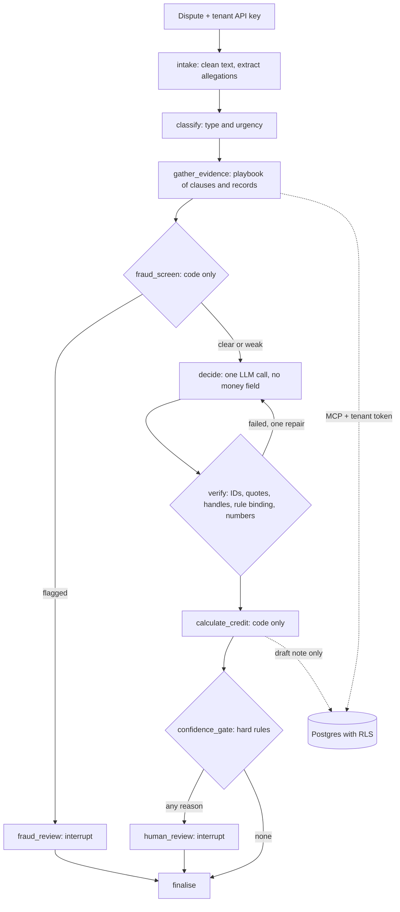

# Adjudicate

A multi-tenant agent for South African telecom billing disputes. A customer disputes a charge. The agent classifies the dispute, retrieves the governing contract clauses, pulls the customer's invoice lines and call records, and recommends `credit_due`, `charge_valid` or `needs_review`, citing both the clause and the records. Code computes the money. Suspected fraud goes to a person.

All operators, customers and records are fictional. This is a portfolio project, not a billing product or legal advice.

## Status

**In progress.** The system runs end to end on a real model, and its deterministic parts are tested. There are no reportable results yet, because every label is still an unreviewed draft. Measurements on those draft labels, and what remains, are in [`docs/PROGRESS.md`](docs/PROGRESS.md).

## Results

<!-- results:start -->
**There are no model results to report yet.** A number appears here only for a real model on owner-labelled data.
<!-- results:end -->

## Architecture



## Quickstart

```bash
cp .env.example .env              # add ANTHROPIC_API_KEY for real decisions
docker compose up --build         # Postgres, seed, MCP server, API at :8000/docs and demo at :8000/demo
```

Without Docker, using [uv](https://docs.astral.sh/uv/):

```bash
uv sync --extra ui
uv run poe db-up
uv run poe seed
uv run poe ci                     # lint, types, tests, mutation check. Free.
uv run python -m evals.runner --llm oracle     # free: must score about 100%
uv run python -m evals.runner --llm constant   # free: must score poorly
uv run python -m evals.runner --llm anthropic --limit 5 --budget-usd 2     # paid
```

## What the system decides

| Decision | Meaning |
|---|---|
| `credit_due` | The records show the charge is wrong under a clause, and a credit rule applies. |
| `charge_valid` | The records show the charge is correct, including when a real error has already been credited or is out of window. |
| `needs_review` | The records or clauses can't settle it, or fraud is suspected. A person decides. |

The output is a recommendation with citations and a draft credit note. Nothing is issued to a customer or written to a billing system.

## Combining clauses and records

Tools return aggregates and a short evidence handle, never raw rows. The model cites the handle, and code expands it to record IDs. `verify` then checks that each handle came from this run, each quote is verbatim, and each number in the rationale appears in tool output. So "CDRs 4411-4419" comes from code, not from the model's reading of a table.

## The money boundary

| Step | Who decides |
|---|---|
| Is a credit due, and under which rule? | The model proposes, and code checks |
| Which lines are in scope? | Code, from the rule's predicate |
| How much? | Code, in integer cents |

**Where the model still has influence:** it chooses which rule to propose. `verify` requires the rule to be in force for this tenant and date, with one of its authorising clauses cited, and a rule that matches no lines goes to review. A wrong rule whose predicate also matches could still produce a wrong amount, which is what the exact-credit metric is for. See [ADR 3](docs/adr/0003-money-boundary.md).

**Gold credit amounts are worked out independently,** in [`credit_workings.yaml`](data/golden/credit_workings.yaml), before the calculator existed. Otherwise exact-credit match would be a tautology. That paid off on the first run: see [F-001](docs/failure-log.md).

## Tenant isolation

The database is the boundary, using Postgres row-level security with `FORCE`, a non-owner role and a transaction-local tenant setting. An unset tenant returns nothing, and tools have no tenant argument. [`tests/isolation/mutation_check.py`](tests/isolation/mutation_check.py) applies seven realistic breakages to a scratch database and requires the suite to fail for each. Limits are listed in [ADR 4](docs/adr/0004-tenant-isolation.md).

## Fraud

A code-only screen on call records overrides the model. Dispute text isn't an input, so saying "fraud" can't trigger it. Genuine lookalikes are tested too, so escalating everything can't score well. The low-and-slow pattern is built to evade the screen, and a test records that it does. Results on synthetic patterns say nothing about real-world detection.

## Design decisions

Each has a rejected alternative and what would change it: [`docs/adr/`](docs/adr/).

## Evaluation

The harness runs the real graph and writes raw rows that every headline number recomputes from. It measures decision accuracy with a confusion matrix, wrongful-credit and wrongful-rejection rates, clause and record citation precision and recall, exact credit match, over-credit and under-credit in rand, fraud recall and false escalation, and cost and latency. Failures can be attributed to a layer with oracles. [`evals/gate.py`](evals/gate.py) applies zero-tolerance rules, floors and a noise-aware delta, and treats an outage as errored, not failed.

## Failure analysis

Four real failures, each found by running the system. The [failure log](docs/failure-log.md) has all of them, with rejected fixes and regression tests.

**Prior credits were capped, not netted ([F-001](docs/failure-log.md#f-001-prior-credits-were-capped-not-netted), [`7cae1be`](https://github.com/7irelo/adjudicate-billing-disputes/commit/7cae1be)).** The calculator treated a clause's ceiling as the whole netting rule, so a customer overcharged R30.00 who had already received R10.00 would have got another R30.00. Three of 37 hand-worked amounts disagreed, and one of those exposed the same mistake in my own working. The property test passed throughout, so only the independently worked amounts could catch it. The bug was found before the calculator's first commit, so that commit contains the fix.

**The isolation guard couldn't see the table it exists to catch ([F-005](docs/failure-log.md#f-005-the-catalog-guard-couldnt-see-the-table-it-exists-to-catch), [`9a0e35a`](https://github.com/7irelo/adjudicate-billing-disputes/commit/9a0e35a)).** A new tenant table with no RLS survived the mutation check, with the isolation suite still green. The guard read `information_schema`, which hides tables the connecting role has no privileges on. It now reads `pg_class` and `pg_attribute`. All 7 mutations are now caught, and this one would otherwise have shipped silently.

**Footnotes were parsed as clauses in a real gazette ([F-006](docs/failure-log.md#f-006-footnotes-were-parsed-as-clauses-in-a-real-gazette), [`1223b2e`](https://github.com/7irelo/adjudicate-billing-disputes/commit/1223b2e)).** Every test on my authored documents passed, because they have no footnotes. The first real document broke the parser on its first read, which is the self-authored-world threat in miniature.

**The number audit rejected numbers the prompt had supplied ([F-007](docs/failure-log.md#f-007-the-number-audit-rejected-numbers-the-prompt-had-supplied), [`0d85991`](https://github.com/7irelo/adjudicate-billing-disputes/commit/0d85991)).** On the first full real-model run, 38 of 100 cases needed a paid repair call, and a R2,320.00 credit went to review because the "20" in the dispute date wasn't in any tool output. The scripted oracle could never show this, because its rationales contain no numbers. Repairs fell to 4 in 41 cases on a partial rerun, which isn't a like-for-like comparison. Made-up numbers still fail, and a test checks that.

## Encoder or LLM

**The deliverable is a decision rule, and it's provisional.** The fine-tuned encoder path is built and passes end to end on a tiny random model, but it hasn't been trained on real data, so there's no encoder F1 to weigh yet.

The cost side doesn't depend on labels. This is the daily volume above which a self-hosted encoder is cheaper than calling each LLM to classify, from [`evals/breakeven.py`](evals/breakeven.py) with measured LLM costs:

| LLM | Measured USD per 1k disputes | Break-even, disputes per day |
|---|---:|---:|
| Haiku 5.5 | 0.0336 | about 19,800 |
| Sonnet 5.5 | 0.6721 | about 990 |
| Opus 5.5 | 1.4459 | about 460 |

This assumes a USD 20 per month VM, which is an assumption and not a quote, with no retraining cost. Adding retraining pushes every break-even higher.

**The rule so far:** on cost alone, use Haiku below about 20,000 disputes a day, since an encoder can't pay for itself sooner against it. Choose an encoder below that only for latency or for keeping dispute text in-house, and only if its F1 on human-written disputes holds up. Those costs cover the classification call alone, and they were measured on 150 assistant-written lines.

## Threats to validity

The T&Cs, data and labels share an author, so results may look better than they should. Fraud patterns are synthetic. Sample sizes are small. See the [data card](docs/data-card.md).

## What I'd do with production data

- **Labels:** sample real disputes by type and outcome, and have two trained people label them independently. Measure agreement first, because it caps the accuracy that can be meaningfully claimed.
- **Shadow mode:** run beside human agents with no customer effect, and compare decisions and credit amounts before any route could be automatic.
- **Documents:** re-run the chunking and retrieval comparison on the operator's real terms. The expected winners didn't hold up on the one long real document tested here.
- **Fraud:** re-tune the screen on confirmed cases, because the patterns here are synthetic. Thresholds tuned on my own generator mean little.
- **Classifier and gate:** retrain on real wording, watch the type mix for drift, and re-fit the confidence calibrator, which isn't installed because its features didn't predict correctness here.
- **Privacy:** treat call records and dispute text as personal information under POPIA, including what reaches the model and the traces, and when it's deleted.

## Not in scope

Real customer data, issuing real credits, integrating with a billing system, impersonating any real operator, and real fraud detection claims.

## Regulatory notes

A learner's reading, not legal advice. Regulation 8A of the End-User and Subscriber Service Charter, as substituted in Government Gazette 53991 of 23 January 2026, prohibits out-of-bundle charges without an opt-in, and comes into force twelve months after publication. See [`docs/m0-findings.md`](docs/m0-findings.md).

## Licence

MIT.
