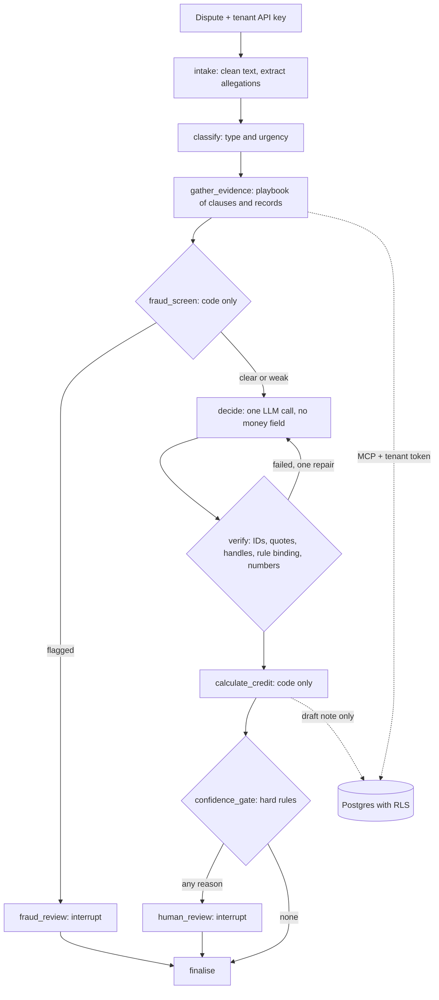

# Adjudicate

A multi-tenant agent for South African telecom billing disputes. A customer disputes a charge. The agent classifies the dispute, retrieves the governing contract clauses, pulls the customer's invoice lines and call records, and recommends `credit_due`, `charge_valid` or `needs_review`, citing both the clause and the records. Code computes the money. Suspected fraud goes to a person.

All operators, customers and records are fictional. This is a portfolio project, not a billing product or legal advice.

## Status

**In progress. There are no model results yet.** The system runs end to end with a scripted model, and its deterministic parts are tested. Decision quality hasn't been measured, because that needs an API key and owner-reviewed labels. See [`docs/PROGRESS.md`](docs/PROGRESS.md).

## Architecture



## Quickstart

```bash
cp .env.example .env              # add ANTHROPIC_API_KEY for real decisions
docker compose up --build         # Postgres, seed, MCP server, API at :8000/docs and demo at :8000/demo
```

Without Docker, using [uv](https://docs.astral.sh/uv/):

```bash
uv sync --extra ui
uv run poe db-up
uv run poe seed
uv run poe ci                     # lint, types, tests, mutation check. Free.
uv run python -m evals.runner --llm oracle     # free: must score about 100%
uv run python -m evals.runner --llm constant   # free: must score poorly
uv run python -m evals.runner --llm anthropic --limit 5 --budget-usd 2     # paid
```

## Combining clauses and records

Tools return aggregates and a short evidence handle, never raw rows. The model cites the handle, and code expands it to record IDs. `verify` then checks that each handle came from this run, each quote is verbatim, and each number in the rationale appears in tool output. So "CDRs 4411-4419" comes from code, not from the model's reading of a table.

## The money boundary

| Step | Who decides |
|---|---|
| Is a credit due, and under which rule? | The model proposes, and code checks |
| Which lines are in scope? | Code, from the rule's predicate |
| How much? | Code, in integer cents |

**Where the model still has influence:** it chooses which rule to propose. `verify` requires the rule to be in force for this tenant and date, with one of its authorising clauses cited, and a rule that matches no lines goes to review. A wrong rule whose predicate also matches could still produce a wrong amount, which is what the exact-credit metric is for. See [ADR 3](docs/adr/0003-money-boundary.md).

**Gold credit amounts are worked out independently,** in [`credit_workings.yaml`](data/golden/credit_workings.yaml), before the calculator existed. Otherwise exact-credit match would be a tautology. That paid off on the first run: see [F-001](docs/failure-log.md).

## Tenant isolation

The database is the boundary, using Postgres row-level security with `FORCE`, a non-owner role and a transaction-local tenant setting. An unset tenant returns nothing, and tools have no tenant argument. [`tests/isolation/mutation_check.py`](tests/isolation/mutation_check.py) applies seven realistic breakages to a scratch database and requires the suite to fail for each. Limits are listed in [ADR 4](docs/adr/0004-tenant-isolation.md).

## Fraud

A code-only screen on call records overrides the model. Dispute text isn't an input, so saying "fraud" can't trigger it. Genuine lookalikes are tested too, so escalating everything can't score well. The low-and-slow pattern is built to evade the screen, and a test records that it does. Results on synthetic patterns say nothing about real-world detection.

## Design decisions

Each has a rejected alternative and what would change it: [`docs/adr/`](docs/adr/).

## Evaluation

The harness runs the real graph and writes raw rows that every headline number recomputes from. It measures decision accuracy with a confusion matrix, wrongful-credit and wrongful-rejection rates, clause and record citation precision and recall, exact credit match, over-credit and under-credit in rand, fraud recall and false escalation, and cost and latency. Failures can be attributed to a layer with oracles. [`evals/gate.py`](evals/gate.py) applies zero-tolerance rules, floors and a noise-aware delta, and treats an outage as errored, not failed.

## Threats to validity

The T&Cs, data and labels share an author, so results may look better than they should. Fraud patterns are synthetic. Sample sizes are small. See the [data card](docs/data-card.md).

## Not in scope

Real customer data, issuing real credits, integrating with a billing system, impersonating any real operator, and real fraud detection claims.

## Regulatory notes

A learner's reading, not legal advice. Regulation 8A of the End-User and Subscriber Service Charter, as substituted in Government Gazette 53991 of 23 January 2026, prohibits out-of-bundle charges without an opt-in, and comes into force twelve months after publication. See [`docs/m0-findings.md`](docs/m0-findings.md).

## Licence

MIT.
